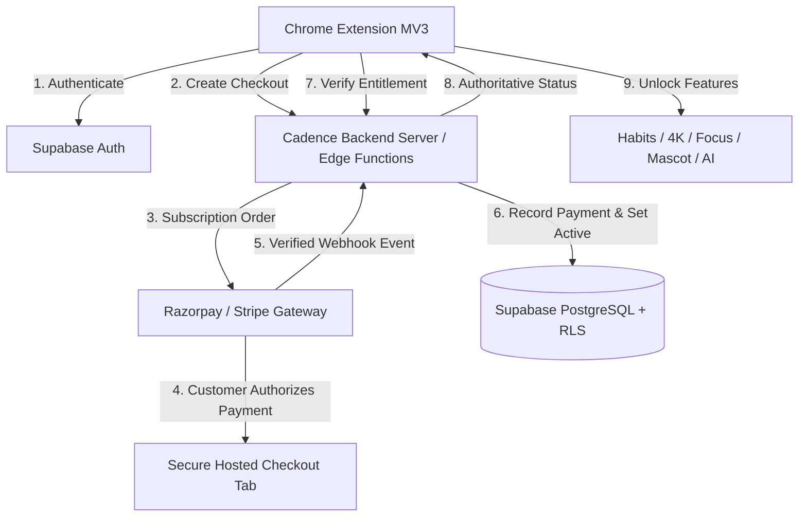

# Cadence Pro — Paid Subscription SaaS Architecture & Deployment Guide

Cadence has been converted from a client-only Chrome extension into a **100% paid, subscription-based SaaS product**. There is no free tier and no free trial.

---

## 1. Business Model & Pricing

* **Monthly Plan:**
  * **Price:** ₹69 INR / month
  * **Billing frequency:** Monthly recurring subscription
  * **Access:** Full access to all Cadence features
  * **Cancellation:** Cancel anytime; access remains valid through the prepaid period

* **Yearly Plan:**
  * **Price:** ₹799 INR / year
  * **Billing frequency:** Annual recurring subscription
  * **Access:** Full access to all Cadence features
  * **Savings:** Save ₹29/year compared to 12 monthly payments (12 × ₹69 = ₹828; ₹828 − ₹799 = ₹29 savings; ₹66/mo equivalent)
  * **Cancellation:** Cancel anytime; access remains valid through the prepaid period

---

## 2. Technology Architecture



### Frontend (Chrome Extension)
* **Manifest Version:** Chrome Manifest V3
* **Pages:**
  * `popup.html` & `popup.js`: Quick checklist, streak stats, quick tools, AI assistant, Pro status indicator.
  * `newtab.html` & `newtab.js`: 4K Wallpaper, Focus Sprints, Soundscapes, Clock, Mascot companion.
  * `dashboard.html` & `dashboard.js`: Habit manager, analytics, heatmaps, reports, Pro settings.
  * `admin.html` & `admin.js`: Protected executive console for user search, subscription status, and revenue analytics.
  * `blocked.html`: Focus Guard website blocker overlay during active sprints.
* **SaaS Modules:**
  * `lib/saas-client.js`: Handles Supabase Auth, Google OAuth, session persistence in `chrome.storage.local`, token refresh, and billing API calls.
  * `lib/saas-ui.js`: Professional SaaS modal layer (Auth view, Pricing cards, Checkout pending spinner, Payment success/failed, Subscription manager, Terms, Privacy, Support).
  * `lib/saas-gate.js`: Central access gatekeeper. Re-verifies entitlement on load and before protected operations. Syncs state across tabs using `chrome.storage.onChanged`.
  * `lib/billing.js`: Unified billing configuration for Razorpay and Stripe with ₹69 and ₹799 plans.

### Backend (Server & Edge Functions)
* **Node.js HTTP Server (`server/`)**: Zero-external-dependency, native HTTP/HTTPS server with rate-limiting, CORS, raw body buffering for webhooks, and sandbox compatibility.
* **Supabase Edge Functions (`supabase/functions/`)**:
  * `checkout/`: Authenticates user, creates subscription with payment gateway.
  * `verify-entitlement/`: Authoritative check of user's active paid status.
  * `cancel-subscription/`: Cancels recurring mandate; marks access through billing period.
  * `razorpay-webhook/`: Verifies `X-Razorpay-Signature` with HMAC SHA256, handles `subscription.charged`, idempotent event processing.
  * `stripe-webhook/`: Verifies `stripe-signature` with tolerance checking, handles `checkout.session.completed` and `invoice.payment_failed`.

### Database (Supabase PostgreSQL)
* Migration: `supabase/migrations/20260928_initial_saas_schema.sql`
* Tables:
  1. `profiles`: id (UUID references `auth.users`), full_name, email, role, created_at, updated_at.
  2. `subscription_plans`: id, plan_code (`monthly`, `yearly`), plan_name, price_inr (69, 799), billing_interval (`month`, `year`), provider_plan_id, is_active.
  3. `subscriptions`: id, user_id, plan_id, provider, provider_customer_id, provider_subscription_id, status (`active`, `canceled`, `expired`, `pending`), current_period_start, current_period_end, cancel_at_period_end, canceled_at.
  4. `payment_events`: id, provider, provider_event_id, event_type, processing_status, payload, error_message, processed_at.
* Row Level Security (RLS):
  * Strict read-only policies for users (`auth.uid() = user_id`).
  * Direct modification of subscriptions is strictly blocked for regular users; only `service_role` backend can write!

---

## 3. Quick Start & Local Development

### Prerequisites
* Node.js v18+ (tested on Node.js 26)

### 1. Install & Run Backend Server
```bash
# Start backend server
npm start
```
The server starts on `http://localhost:3000`.

### 2. Run Automated Test Suite
```bash
npm test
```
Executes 14 unit and integration tests covering:
- Plan pricing and yearly savings (₹69/mo, ₹799/yr, ₹29 savings)
- Unauthenticated request rejection
- Entitlement checks for unsubscribed users
- Checkout session creation
- Webhook signature verification & idempotency
- Cancellation retention through period end
- Admin console authorization

### 3. Load Extension in Google Chrome
1. Open Google Chrome and navigate to `chrome://extensions/`.
2. Enable **Developer mode** (toggle in top right).
3. Click **Load unpacked**.
4. Select the project directory (`/Users/maheshpawar/field-ledger-pro 3`).
5. Open a new tab (`chrome://newtab`) or click the Cadence extension icon in the toolbar.
6. The SaaS Paywall will appear:
   - Click **Create Account** or **Sign In**.
   - Select **Subscribe Monthly (₹69)** or **Subscribe Yearly (₹799)**.
   - The checkout page opens in a secure tab. Complete checkout or click **Simulate Instant Payment** in sandbox.
   - Once verified, full Pro features unlock across all tabs!

### 4. Open Executive Admin Console
1. Open `admin.html` in your browser.
2. Enter the `ADMIN_SECRET_KEY` configured in `.env` (default in dev: `cadence_admin_secure_secret_2026`).
3. Click **Authenticate Console** to view registered users, active subscriptions, revenue metrics, and webhook audit logs.

---

## 4. Production Deployment & Gateway Setup

### A. Razorpay Subscriptions (Recommended for India)
1. Register and complete KYC at [Razorpay Dashboard](https://dashboard.razorpay.com/).
2. Under **Subscriptions > Plans**, create two plans:
   * **Monthly Plan:** Name: "Cadence Pro Monthly", Amount: ₹69, Billing Cycle: Monthly. Note the `plan_id` (e.g. `plan_XXXXX`).
   * **Yearly Plan:** Name: "Cadence Pro Yearly", Amount: ₹799, Billing Cycle: Yearly. Note the `plan_id`.
3. Under **Settings > API Keys**, generate your Key ID and Key Secret.
4. Under **Settings > Webhooks**, add your backend webhook endpoint:
   * URL: `https://your-backend.domain.com/api/webhooks/razorpay` (or your Supabase Edge Function URL)
   * Secret: Set a secret key (copy to `RAZORPAY_WEBHOOK_SECRET`)
   * Events to subscribe:
     - `subscription.authenticated`
     - `subscription.activated`
     - `subscription.charged`
     - `subscription.cancelled`
     - `subscription.halted`
     - `payment.captured`
     - `payment.failed`

### B. Supabase Setup
1. Create a project at [database.new](https://database.new).
2. Go to **SQL Editor** in Supabase and run `supabase/migrations/20260928_initial_saas_schema.sql`.
3. Under **Authentication > URL Configuration**, add your Chrome Extension redirect URL:
   `https://<extension-id>.chromiumapp.org/`
4. Under **Project Settings > API**, copy `URL`, `anon public key`, and `service_role secret`.
5. Populate your production `.env` or cloud environment variables (see `.env.example`).

---

## 5. Chrome Web Store Preparation

1. **Manifest V3:** The extension uses Manifest V3 with minimum permissions (`storage`, `unlimitedStorage`, `alarms`, `notifications`, `topSites`, `bookmarks`, `identity`, `tabs`).
2. **CSP & Security:** All scripts are bundled locally in `lib/`. No remote executable code or `eval()` is used.
3. **External Payment Links:** Checkout is launched in a regular browser tab via `chrome.tabs.create({ url })` to comply with payment security and CSP.
4. **Build Package:**
   To prepare a zip for the Chrome Web Store:
   ```bash
   zip -r cadence-pro-release.zip manifest.json *.html *.css *.js icons/ assets/ Wallpaper/ lib/ -x "*.DS_Store"
   ```
5. Upload `cadence-pro-release.zip` to the [Chrome Developer Dashboard](https://chrome.google.com/webstore/devconsole).

---

## 6. Security Considerations & Protections

* **No Client Trust:** Client-side flags (`isPro`, `localStorage`) are never trusted for entitlement. The backend `/api/subscription/verify` endpoint is the sole authority.
* **RLS Protection:** The `subscriptions` table has RLS enabled with only `SELECT` permitted for authenticated users. Insert and update policies are completely restricted to `service_role`.
* **Signature Verification:** All incoming webhooks from Razorpay and Stripe are verified using timing-safe HMAC SHA256 comparisons to prevent tampering.
* **Idempotency:** Webhook event IDs are tracked in `payment_events`. Duplicate deliveries are safely ignored.
* **Cancellation Grace Period:** If a user cancels, `cancel_at_period_end` is set to `true`. Access remains active until `current_period_end`.
